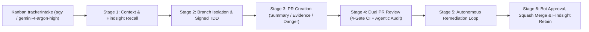

# Fully Autonomous Development Pipeline Specification

This document defines the 6-stage **Fully Autonomous Development Pipeline** governing all code, firmware tooling, acoustic filter, and documentation changes in `TinkeringDao/Woke-Bose`. Every autonomous agent and contributor workflow must execute these stages end-to-end without bypassing branch protection, cryptographic commit verification, or statutory clean-room invariants.



---

## Kanban `trackerIntake` Worker Loop (`agy` / `gemini-4-argon-high`)

Autonomous issue intake and pull request execution are driven by the Kanban `trackerIntake` worker loop running on the **Gemini 4 Argon** engine (`agy` / `gemini-4-argon-high`):

1. **Issue Polling & Triage Intake (`trackerIntake`)**: The orchestrator polls GitHub Issues in `TinkeringDao/Woke-Bose` for actionable items (`ready-for-agent` or assigned tracker issues) and provisions an isolated git worktree per issue. If an issue requires architectural human judgment beyond repository specifications, the worker classifies it as `needs-human-review` (`ready-for-human`) and halts without opening a speculative PR.
2. **Isolated Worktree Execution (`agy` / `gemini-4-argon-high`)**: A dedicated Gemini 4 Argon (`agy` / `gemini-4-argon-high`) worker executes Stages 1–6 inside its isolated worktree—recalling Hindsight context via `${HINDSIGHT_URL}`, authoring `ED25519`-signed commits as `TinkeringDao`, verifying zero-warning Objective-C/Bash/Python builds, and opening a Pull Request referencing `Closes #<issue_number>`.
3. **End-to-End Review, Thread Resolution & Squash Merge**: The worker monitors the 4-Gate CI workflow and inline `reviewThreads`, pushes signed remediation commits until all gates pass and every inline review thread has `isResolved == true`, and completes the squash-merge into `main` followed by Hindsight memory retention.

---

## Stage 1: Context & Hindsight Recall

Before modifying any file or opening a branch:

1. **Hindsight Memory Recall**: Query the persistent Hindsight vector/graph memory bank via `${HINDSIGHT_URL}` (defaulting example to `http://127.0.0.1:9100`) for prior architectural decisions, BMAP protocol invariants, and legal baselines:
   ```bash
   export HINDSIGHT_URL="${HINDSIGHT_URL:-http://127.0.0.1:9100}"
   curl -s -X POST "${HINDSIGHT_URL}/v1/default/banks/${HINDSIGHT_BANK}/memories/recall" \
     -H "Content-Type: application/json" \
     -d '{"query": "Woke-Bose BMAP RFCOMM NVRAM CoreAudio legal baseline"}'
   ```
2. **Mandatory Repository Context**: Read the canonical governance and domain files:
   - [`AGENTS.md`](../../AGENTS.md) — Repository entry point and verification commands.
   - [`LEGAL.md`](../../LEGAL.md) — 8-pillar EU/US statutory interoperability baseline and the `Addendum: German Statutory References (Applicable to Residents of Germany)`.
   - [`SECURITY.md`](../../SECURITY.md) — Vulnerability disclosure policy and clean-room hardware boundary rules.
   - [`docs/agents/domain.md`](domain.md), [`GLOSSARY.md`](../../GLOSSARY.md), and [`docs/ARCHITECTURE.md`](../ARCHITECTURE.md) — Canonical BMAP terminology (`Lonestarr`, `BMAP`, `SETGET`, `Baseline`, `Woke`).

---

## Stage 2: Branch Isolation & Signed TDD Implementation

Direct pushes to `main` are blocked by the repository ruleset (`Protect main branch`).

1. **Branch Isolation**: Sync `main` from `origin/main` and create an isolated topic branch (or `trackerIntake` worktree branch) using a canonical prefix (`feat/*`, `fix/*`, `chore/*`, `docs/*`, `refactor/*`, `ao/*`):
   ```bash
   git fetch origin
   git checkout -B main origin/main
   git checkout -B fix/<topic-name>
   ```
2. **Cryptographic Git Identity & SSH Signing**: Every commit must be authored as `TinkeringDao <203040288+TinkeringDao@users.noreply.github.com>` and signed with an `ED25519` SSH key (`commit.gpgsign=true`, `gpg.format=ssh`, `-S`):
   ```bash
   git config user.name "TinkeringDao"
   git config user.email "203040288+TinkeringDao@users.noreply.github.com"
   git config commit.gpgsign true
   ```
3. **Zero-Warning Build & Syntax Verification**: Verify all changes locally prior to committing:
   - Compile [`bose_ultra_tuner.m`](../../bose_ultra_tuner.m) with `-Wall -Wextra -Werror` via `make`.
   - Validate [`bose-ultra-wizard.sh`](../../bose-ultra-wizard.sh) via `bash -n bose-ultra-wizard.sh`.
   - Validate [`parse_appuhdr5.py`](../../parse_appuhdr5.py) via `python3 -m py_compile parse_appuhdr5.py`.

---

## Stage 3: Pull Request Creation

Push the signed branch to `origin` and open a Pull Request against `main` conforming to [`.github/PULL_REQUEST_TEMPLATE.md`](../../.github/PULL_REQUEST_TEMPLATE.md) and referencing the tracker issue (`Closes #<issue_number>`):

- **`## Summary`**: Architectural context, affected BMAP Function Blocks or scripts, and control-flow diagram where applicable.
- **`## Evidence`**: Deterministic `Before` vs. `After` build/test transcripts, CLI output, or hardware packet traces (with personal Bluetooth MAC addresses and serial numbers redacted).
- **`## Merge Danger`**: Explicit reversibility and impact classification:
  - `**Door:** two-way | one-way`
  - `**Blast Radius:** local | module | system`

---

## Stage 4: Dual GitHub PR Review (Automated CI Gate + Agentic Spec/Code/Security Review)

Every Pull Request undergoes two complementary review tracks directly on GitHub:

1. **Automated 4-Gate GitHub Actions Workflow ([`.github/workflows/autonomous-pr-review.yml`](../../.github/workflows/autonomous-pr-review.yml))**:
   - **Gate 1 (OPSEC & Zero-PII Check)**: Scans the entire working tree to ensure zero personal identifiers, local host usernames, postal codes, geographic coordinates, or cross-organization identifiers exist.
   - **Gate 2 (Cryptographic Commit Signature Verification)**: Queries `repos/{owner}/{repo}/pulls/{pr_number}/commits` (`--paginate`) to verify that every commit in the PR has `commit.verification.verified == true`.
   - **Gate 3 (Legal, Governance, Autonomous Spec Integrity & Inline Review Threads)**: Verifies non-empty presence of `LEGAL.md`, `LICENSE`, `SECURITY.md`, `CODE_OF_CONDUCT.md`, `.github/CODEOWNERS`, `AGENTS.md`, `CLAUDE.md`, and `docs/agents/autonomous-pipeline.md`, confirms `LEGAL.md` retains `Addendum: German Statutory References`, and queries `repository.pullRequest.reviewThreads(first: 100) { nodes { isResolved } }` via `gh api graphql` to fail the gate if any inline review thread has `isResolved == false`.
   - **Gate 4 (Project Syntax & Verification Gate)**: Runs `python3 -m py_compile parse_appuhdr5.py` and `bash -n bose-ultra-wizard.sh` (alongside the macOS `CI` workflow compiling `bose_ultra_tuner.m`).
2. **Independent Reviewer Subagent Audit (`superpowers:subagent-driven-development` + `code-review` + `security-review`)**:
   - An independent Reviewer Subagent inspects `gh pr diff <PR_NUMBER>` against the specification, clean-room statutory bounds, and security invariants.
   - The Reviewer Subagent posts a structured review directly on the GitHub PR (`gh pr review <PR_NUMBER> --comment --body "..."`) enumerating any concrete findings or improvements required before merge.

---

## Stage 5: Autonomous Remediation Loop

Because the `Protect main branch` ruleset enforces `dismiss_stale_reviews_on_push: true` and `require_last_push_approval: true`:

1. Any finding raised by the Reviewer Subagent, any unresolved inline review thread (`isResolved == false`), or any failure in the 4-Gate CI workflow is remediated directly on the PR branch by the `agy` (`gemini-4-argon-high`) worker.
2. Remediation changes are committed with an `ED25519` SSH signature (`fix(<scope>): address PR review ...`), pushed to the PR branch, and any addressed inline `reviewThreads` are resolved.
3. A structured remediation summary comment is posted on the PR (`gh pr comment <PR_NUMBER> --body "## Autonomous Remediation Complete ..."`), and the 4-Gate workflow automatically re-evaluates the updated `HEAD` commit.

---

## Stage 6: Automated Approval, Squash Merge & Hindsight Retention

1. **Automated GitHub Approval**: Once all 4 CI gates pass (including zero unresolved `reviewThreads`) on the latest remediated commit and the PR author is verified as `TinkeringDao` on a same-repository branch, `github-actions[bot]` executes `gh pr review <PR_NUMBER> --approve`, satisfying `required_approving_review_count: 1` and `require_last_push_approval: true`.
2. **Squash Merge & Branch Cleanup**: The approved PR is merged into `main` and the remote feature branch is deleted:
   ```bash
   gh pr merge <PR_NUMBER> --squash --delete-branch
   ```
3. **Hindsight Knowledge Retention**: The merged commit SHA, PR number, and architectural summary are persisted back to the Hindsight memory bank (`POST ${HINDSIGHT_URL}/v1/default/banks/${HINDSIGHT_BANK}/memories`, where `HINDSIGHT_URL` defaults to `http://127.0.0.1:9100`) so subsequent autonomous runs inherit the updated state.
